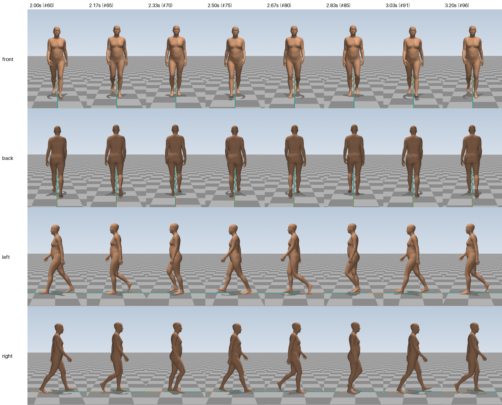

# E01: Straight walk, from scratch, blind

> **Summary.** We asked the agent to make the SMPL-X body walk 6 seconds in a straight line, using only its own knowledge: no motion data, and no way to see or measure its result. After 61 minutes it delivered a walk at a normal human pace (1.23 m/s, 113 steps per minute). Measured on the real body mesh, the feet neither slide nor sink into the floor, and every measurement target is met. The most important finding: without any data or visual feedback, the agent built a complete, physically careful walking generator from first principles.

| | |
|---|---|
| **Experiment ID** | `E01-straight-walk` |
| **Date** | 2026-11-01 |
| **Task** | Walk forward in a straight line, already walking at the start and at the end, 6 s ([`tasks/straight-walk.json`](../../tasks/straight-walk.json)) |
| **Agent** | Claude Code, model Claude Opus 5.5, headless |
| **Started from** | scratch |
| **Tools the agent had** | none (blind): no renderer, no measuring tool |
| **Session** | 61 min, 75 turns, $12.71 |
| **Result** | all 11 measurement targets met; a natural walking pattern in still frames |
| **Folder** | [`runs/E01-straight-walk/`](../../runs/E01-straight-walk/) |
| **Main video** | [`runs/E01-straight-walk/videos/grid.mp4`](../../runs/E01-straight-walk/videos/grid.mp4) |

## 1. Why this experiment

The starting question of the project: can an AI agent make a 3D human body walk realistically using nothing but what it knows? We gave it the strictest version: no motion data, and it could not see what it produced. This shows the agent's knowledge and reasoning in their purest form, and gives us a baseline for everything that follows.

## 2. The task

The person walks forward along a straight line, on flat ground, at a natural pace. The clip is 6 seconds (180 frames at 30 frames per second). The person is already walking when the clip starts and still walking when it ends, so no starting or stopping is needed.

The agent was told how the result would be judged: four videos (front, back, left, right) watched by people who know what walking looks like, who look for sliding or sinking feet, body parts passing through each other, robotic movement, wrong joint bending, poor coordination, a speed that does not match the legs, and limping. It was not told anything about *how* people walk: no joint angles, step lengths or rhythms.

This experiment used the first version of the prompt, which asked for a program named `generate_motion.py`. The exact text the agent received is in [`runs/E01-straight-walk/TASK.md`](../../runs/E01-straight-walk/TASK.md). Later experiments use the general prompt described in [How an experiment works](../01-setup.md).

## 3. What the agent did

The session had three phases:

| Time | What happened |
|---|---|
| 0–13 min | **Planning.** The agent read the documents and then thought for 11 minutes without acting, designing the whole approach, before writing a first program of about 700 lines. |
| 13–24 min | **First version.** It ran the program, rewrote it once, and wrote its own checking tool (`analyze.py`) that computes where the feet and other body parts are, from the joint rotations. |
| 24–61 min | **Refining.** About 25 rounds of: change the program, run it (15–120 s each, because part of the computation is an optimisation), check the numbers. |

**The approach, in plain words.** The agent did not draw joint angles freehand. It built the walk the way a careful animator or a robotics engineer would:

1. **A rhythm.** One clock drives everything: one full stride every 1.06 seconds. The rhythm varies very slightly over time, so no two steps are exactly the same length in time.
2. **Footprints first.** It decides where each foot lands on the floor. From the moment a heel touches down until the toes leave, that foot is pinned to the floor, so it cannot slide.
3. **The foot rolls.** During each step the foot rolls over the ground the way a real foot does: first on the rounded back of the heel, then flat, then the heel lifts and the foot rolls over the ball and the toes.
4. **Legs reach the feet.** The hip and knee angles are *computed* so that the leg exactly reaches the pinned foot. This technique is called [inverse kinematics](../glossary.md#animation-and-the-body-model).
5. **Hip height is solved, not guessed.** How high the pelvis is at each moment is calculated so that the knee of the standing leg bends the way a real knee does during a step: slightly at heel contact, a bit more as the body's weight lands on it, then almost straight.
6. **The swinging leg** moves along smooth curves from toe-off to the next heel contact, with the knee bending to about 60° so the foot clears the ground by 1.6–1.9 cm.
7. **Upper body.** The chest turns slightly against the hips, the head is kept steady and looks a little down the path, the arms swing opposite to the legs with slightly bent elbows, and the palms face the thighs.

**Problems it found and fixed by itself, all by calculation:**

- Its first stride was too long for this body's legs: in the moment before the toes leave the ground, even a fully straight leg could not reach the foot. It shortened the stride to 1.30 m and added rolling over the toes.
- The SMPL-X skeleton is not perfectly symmetric. The left knee is slightly bent when standing, the right leg is 9 mm shorter, and the left elbow sits 3 cm lower. Equal joint angles on both sides would have produced a slight limp and an arm hanging into the body. The agent measured these differences and compensated for them by fractions of a degree.
- A mathematical shortcut made the swinging leg's curves overshoot wildly; it replaced it with a simpler model of how the leg arrives at heel contact.

The agent's own account is in [`NOTES.md`](../../runs/E01-straight-walk/NOTES.md). Its program is [`generate_motion.py`](../../runs/E01-straight-walk/generate_motion.py).

## 4. Results

### Videos and images

- **All six views in one video:** [`grid.mp4`](../../runs/E01-straight-walk/videos/grid.mp4)
- Single views (local copies only, re-create with `python -m walkenv.render runs/E01-straight-walk`): `front.mp4`, `back.mp4`, `left.mp4`, `right.mp4`, `top.mp4`, `overview.mp4` in the same folder
- About one stride, close up, from the four follow cameras:

The videos were first rendered with four cameras on 2026-11-01 and re-rendered later that day with the current six-camera setup, so all experiments look the same. The motion itself is unchanged.

### Measurements

| | Measurement | Value | Target |
|---|---|---|---|
| ✅ | Deepest sinking into the floor | 2.68 mm | ≤ 10 mm |
| ✅ | Frames sinking more than 1 cm | 0 frames | 0 |
| ✅ | Frames with nothing on the floor | 0 frames | 0 |
| ✅ | Typical speed of floor-touching skin | 0.42 cm/s | ≤ 1 cm/s |
| ✅ | Speed of floor-touching skin, 95th percentile | 1.34 cm/s | ≤ 3 cm/s |
|  | Distance travelled by the pelvis | 7.18 m |  |
|  | Average speed | 1.2 m/s |  |
| ✅ | Average distance from the path | 1.37 cm | ≤ 15 cm |
| ✅ | Largest distance from the path | 2.68 cm | ≤ 15 cm |
| ✅ | Start position error | 1.24 cm | ≤ 15 cm |
| ✅ | Start heading error | 2.87 ° | ≤ 15° |
| ✅ | Fastest joint rotation | 418.93 °/s | ≤ 800 °/s |
| ✅ | Frames with a pop | 0 frames | 0 |

What the measurement terms mean is explained on the [measurements page](../02-measurements.md).

**Reading:**

- The feet never sink more than 2.7 mm into the floor, which is invisible. At no moment are both feet off the ground.
- Skin touching the floor moves at a median of 0.4 cm/s: planted feet effectively stay put. The small motion that remains comes from the heel and toes rolling.
- This is notable, because the agent never had the body mesh. It placed the feet using only a few landmark points (heel, toe tip, sole edges) and its own geometric model of the heel, yet the real skin lands within millimetres of the floor.
- Its own numbers agree with ours: 1.23 m/s and 113 steps per minute, with steps of 0.65 m. These are normal values for a comfortable adult walk, and the agent chose them to match this body's leg length.

### What we see

This assessment is based on still frames from the videos (the contact sheet above and individual frames). The moving videos should be watched to confirm it.

- **Clearly human walking pattern:** heel first, rolling over the foot, pushing off with the toes; the swinging knee bends visibly; there are moments with both feet on the ground.
- **Arms swing opposite to the legs**, with relaxed, slightly bent elbows. The upper body and head stay calm.
- **Seen from the front and back** the feet land close to a line, with a slight outward turn of the toes, as in real walking.
- **To check in the videos:** the agent itself warned that the moment of heel contact might look slightly "stompy", and that the motion is very regular (every stride almost identical, fingers never move).

## 5. Problems and limitations

- **Very regular:** apart from small built-in variations in timing, arm swing and head, every stride is the same. Real people vary more.
- **Hands are static:** the fingers stay in the default relaxed pose.
- **Heel contact** may look a little abrupt (the agent's own concern).
- **Only straight walking:** the code assumes the person always walks along +Z at a constant speed. Turning, curves, starting and stopping are not possible without changes. This is the main limitation addressed by the following experiments.
- **Slow and costly to produce:** 61 minutes and $12.71 for one 6-second clip. Most of the time went into the agent thinking and into fine-tuning details that are invisible to a viewer. Generating the clip once the program exists takes about 15 seconds.

## 6. Conclusion and next step

The agent can produce a convincing straight walk from knowledge alone, and its approach (pinned footprints, computed legs, solved hip height) is the same one used for footstep-based animation in research and games. That approach can be extended to paths, turns and obstacles.

**Next:** in [E02](E02-curved-path.md) the agent starts from this code, with tools to measure and look at its result, and must walk an S-shaped path. That requires the body to change direction, which this code cannot do yet.

## Files in the experiment folder

| File | Content |
|---|---|
| [`TASK.md`](../../runs/E01-straight-walk/TASK.md), [`CLAUDE.md`](../../runs/E01-straight-walk/CLAUDE.md) | exactly what the agent was told (first prompt version) |
| [`generate_motion.py`](../../runs/E01-straight-walk/generate_motion.py) | the agent's walking program |
| [`analyze.py`](../../runs/E01-straight-walk/analyze.py) | the agent's own checking tool |
| [`NOTES.md`](../../runs/E01-straight-walk/NOTES.md) | the agent's own account |
| `motion.npz` | the motion (SMPL-X parameters for 180 frames) |
| [`motion.metrics.json`](../../runs/E01-straight-walk/motion.metrics.json) | the measurements |
| `transcript.jsonl`, [`run_summary.json`](../../runs/E01-straight-walk/run_summary.json) | the full session log, and its key facts |
| [`task.json`](../../runs/E01-straight-walk/task.json) | the task in the current task-file format (added afterwards; E01 itself predates task files) |
| `videos/` | rendered videos and images |

The folder was originally named `20261101-192803_claude_blind`. It was renamed to `E01-straight-walk` when the naming scheme was introduced; [`run.json`](../../runs/E01-straight-walk/run.json) records the original name.
