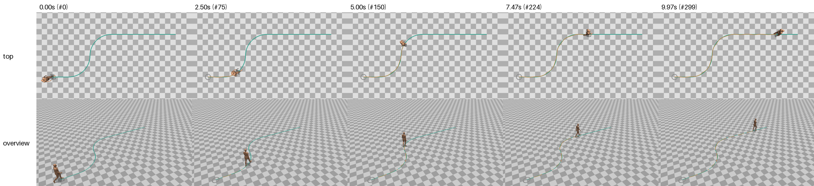
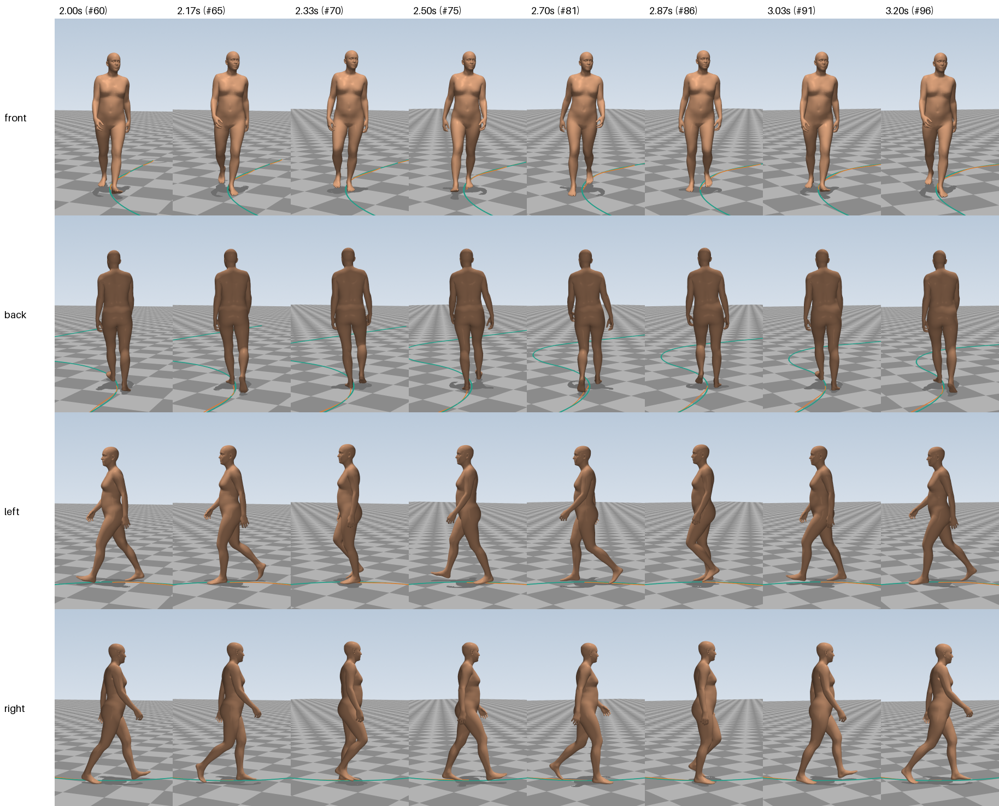

# E02: Walking an S-shaped path

> **Summary.** Starting from E01's straight-walking program, the agent had to make the person follow an S-shaped path: a bend to the left, a bend to the right, then straight on. In 38 minutes (half of E01's time, at half the cost) it turned E01's single script into a general motion library that follows any path. The person slows down slightly in the bends, leans into them and looks ahead into each turn. All measurement targets are met on the new task and on the old straight walk, and a 10-second clip now takes 4 seconds to compute. The agent itself found the next limit: sharp corners (90°) need a different turning technique, which is what E03 asks for.

| | |
|---|---|
| **Experiment ID** | `E02-curved-path` |
| **Date** | 2026-11-01 |
| **Task** | Follow an S-shaped path (two bends of 2 m radius), already walking, 10 s ([`tasks/curved-path.json`](../../tasks/curved-path.json)) |
| **Agent** | Claude Code, model Claude Opus 5.5, headless |
| **Started from** | the code of [E01](E01-straight-walk.md) |
| **Tools the agent had** | `evaluate.py` (used 4 times), `preview.py` (used 4 of 8 allowed) |
| **Session** | 38 min, 79 turns, $6.52 |
| **Result** | 11/11 measurement targets met on the S-path and on the straight walk; 4 s to compute a 10 s clip |
| **Folder** | [`runs/E02-curved-path/`](../../runs/E02-curved-path/) |
| **Main video** | [`runs/E02-curved-path/videos/grid.mp4`](../../runs/E02-curved-path/videos/grid.mp4) |

## 1. Why this experiment

E01's program could only walk in one fixed direction: the direction (+Z) was built into every part of it. Real tasks need the person to follow a route. A curved path is the gentlest way to introduce changing direction, because the walking rhythm can stay the same and the turning is spread over many steps. This experiment also introduced the new way of working: the agent starts from earlier code, has tools to measure and look at its result, and must keep the earlier task working.

## 2. The task

The person is already walking at the start and follows a marked path: 1.5 m straight, a 90° bend to the left with a 2 m radius, a 90° bend to the right with a 2 m radius, then straight on. The clip is 10 seconds (300 frames); the path is longer than the person can walk in that time, so the clip ends while they are still walking. The pelvis has to stay within 15 cm of the path.

The full prompt is in [`runs/E02-curved-path/TASK.md`](../../runs/E02-curved-path/TASK.md). It also asked for:

- a reusable library instead of a single script, because later experiments will build on it;
- generation in at most about 1 second of computing per second of motion;
- notes written for a non-specialist reader.

**What makes it harder than E01:**

- the body has to turn with the path, so the direction of every step changes;
- in a bend the inner and outer feet travel different distances;
- a real walker leans into a bend, slows down a little, and looks into the turn before the body follows.

## 3. What the agent did

**The session, in phases:**

| Time | What happened |
|---|---|
| 0–4.5 min | Read the task and E01's code and notes. Before changing anything, it measured E01's motion with the new `evaluate.py` to have a baseline. |
| 4.5–12 min | Planning. |
| 12–16 min | Wrote the whole new library, 9 modules, in about four minutes. |
| 16 min | First measurement of the new motion: all targets met. |
| 17–31 min | Looked at four previews (the first bend, the switch from left to right bend, the entry into the first bend, the exit to the straight) and wrote extra test tasks of its own to check that the code is general. |
| 31–38 min | Checked that the straight walk still works, checked determinism, and wrote the notes. |

It made no changes because of the previews: the first version already looked right to it.

**How the new program works**, in plain words (the agent's full account is in [`NOTES.md`](../../runs/E02-curved-path/NOTES.md)):

1. **Walking line.** The marked path is smoothed into the line the pelvis actually follows. The path's curvature jumps abruptly where a straight piece meets a bend, and a real walker cannot start turning at full rate instantly. After smoothing, the turning builds up over about a metre, and the line stays within about 2 cm of the marked path.
2. **Speed.** The person slows down slightly in bends, and starts slowing before reaching them: from 1.23 m/s on the straight to about 1.12 m/s in the 2 m bends. Part of the slow-down comes from slower steps and part from shorter steps.
3. **Leaning into the bend.** To go round a curve, the body's weight has to sit on the inside of the feet. The agent calculated the lean this needs from the speed and the radius, about 3.9°, and used 85 % of it, because a real foot can also push sideways. The whole body leans in, and the feet land slightly to the outside.
4. **Footprints along the curve.** Each foot is placed along the curve, pointing along the path a little ahead. In a bend each foot turns 30–35° from one footprint to the next. The inner foot's strides are shorter (1.21 m) than the outer foot's (1.29 m), as in real curved walking.
5. **Looking ahead.** The head turns towards a point on the path 1.6 m ahead, so it starts turning about half a second before the body and leads by up to 20° in the bends. The chest follows, then the pelvis: the same "head first, then trunk, then hips" order people show when they turn.
6. **Kept from E01:** the foot rolling, the legs computed to reach the pinned feet ([inverse kinematics](../glossary.md#animation-and-the-body-model)), the swing of the free leg, the arm swing.
7. **Faster.** E01 used a slow numerical optimisation to find the hip height. The agent replaced it with formulas plus one fast smoothing fit, and computed all frames at once. Generation went from 15 s for 6 s of motion to under 1 s of computing for 10 s of motion (4 s including Python start-up).

**The agent's own generality tests** (in [`test_tasks/`](../../runs/E02-curved-path/test_tasks/)): a tight half-circle of 1 m radius, a path with 56° and 45° corners, and a start facing a different direction all worked. A **90° corner did not**: the body had to turn about 60° over a single planted foot, the ankle twisted unnaturally and the foot slid for a frame or two. The agent noted that people turn sharp corners with dedicated pivot or step turns, which the program does not have.

## 4. Results

### Videos and images

- **All six views in one video:** [`grid.mp4`](../../runs/E02-curved-path/videos/grid.mp4)
- Single views (local copies only, re-create with `python -m walkenv.render runs/E02-curved-path`): `front.mp4`, `back.mp4`, `left.mp4`, `right.mp4`, `top.mp4`, `overview.mp4` in the same folder
- The whole path from above and from the overview camera, at five moments:

- One stride, close up, from the four follow cameras ([`contact_sheet.png`](../../runs/E02-curved-path/videos/contact_sheet.png)):

### Measurements

**S-shaped path** (the new task):

| | Measurement | Value | Target |
|---|---|---|---|
| ✅ | Deepest sinking into the floor | 2.64 mm | ≤ 10 mm |
| ✅ | Frames sinking more than 1 cm | 0 frames | 0 |
| ✅ | Frames with nothing on the floor | 0 frames | 0 |
| ✅ | Typical speed of floor-touching skin | 0.38 cm/s | ≤ 1 cm/s |
| ✅ | Speed of floor-touching skin, 95th percentile | 1.27 cm/s | ≤ 3 cm/s |
|  | Distance travelled by the pelvis | 11.55 m |  |
|  | Average speed | 1.16 m/s |  |
| ✅ | Average distance from the path | 1.86 cm | ≤ 15 cm |
| ✅ | Largest distance from the path | 4.62 cm | ≤ 15 cm |
| ✅ | Start position error | 0.9 cm | ≤ 15 cm |
| ✅ | Start heading error | 2.87 ° | ≤ 15° |
| ✅ | Fastest joint rotation | 449.19 °/s | ≤ 800 °/s |
| ✅ | Frames with a pop | 0 frames | 0 |

**Straight walk** (E01's task, which the new code must still handle): 11 of 11 targets met. The values are practically the same as E01's (for example 0.40 cm/s typical skin speed versus 0.42, and 2.62 mm deepest sinking versus 2.68), because the new code reproduces the old walk.

**Reading:**

- Following the curves costs nothing in quality: the feet stay planted (median 0.38 cm/s) and never sink more than 2.6 mm, just as on the straight line.
- The pelvis stays within 4.6 cm of the marked path at its worst point, well inside the 15 cm tolerance. The small deviation is mostly the deliberate smoothing of the abrupt curvature changes.
- The average speed (1.16 m/s) is a little below E01's 1.20 m/s because of the slow-down in the bends.

We checked the agent's numbers independently. Our own run of the measurements gives the same values, `make_motion.py` regenerates the straight walk bit for bit, and it computes the 10-second S-path in 4.0 s of wall-clock time.

### What we see

This assessment is based on still frames from the videos (the two sheets above). The moving video should be watched to confirm it.

- **The route is followed closely.** In the top view, the orange pelvis trail lies on the teal path through both bends. There is no visible corner-cutting and no drifting wide.
- **The head leads into the bend.** In the close-up taken inside the first (left) bend, the face is turned slightly to the person's left, towards where the path goes, ahead of the body. This is the "look where you are going" behaviour the agent built in.
- **The walking pattern is unchanged from E01:** heel first, rolling over the foot, push-off with the toes, opposite arm swing. The bend does not disturb it.
- **The lean into the bend is subtle** (about 3°) and hard to see in still frames; it should be judged in the moving video.
- **To check in the video:** whether the smooth slowing down in the bends is noticeable, and the moment where the path switches from the left bend to the right bend (around 4–5 s), where the head swings over first.

## 5. Problems and limitations

- **Sharp corners are not possible yet.** The program turns by rotating the body gradually over the planted feet, step after step. That works for bends down to about 1 m radius, but a 90° corner needs a pivot or step turn, which it does not have. This is the agent's own finding and the main reason for E03's task.
- **Starting, stopping and obstacles are not supported.** The program warns, and walks steadily along the path, if a task asks for them.
- **Arms and gaze in bends are simple.** The arms swing exactly as on a straight line. The head tracks a fixed point ahead smoothly, while real gaze jumps ahead in quick movements.
- **Inherited from E01:** very regular steps, static hands, gait curves tuned from memory, and a possibly abrupt heel contact.

## 6. Conclusion and next step

Starting from existing code, with measuring and preview tools, the agent generalised straight walking to arbitrary smooth paths in half the time and cost of E01, without losing any quality. It also made the program about 20 times faster per second of motion and turned it into a reusable library. Its turning behaviour (slowing, leaning, looking ahead, head before trunk before hips) is grounded in physics and in how people move, not in data. The previews did not lead to any change, which suggests the agent's own numerical checks already caught what mattered.

**Next:** [E03](E03-turns.md) asks for exactly what the agent identified as missing: starting from standing, a sharp 90° corner, stopping, and turning around on the spot.

## Files in the experiment folder

| File | Content |
|---|---|
| [`TASK.md`](../../runs/E02-curved-path/TASK.md), [`CLAUDE.md`](../../runs/E02-curved-path/CLAUDE.md) | exactly what the agent was told |
| [`make_motion.py`](../../runs/E02-curved-path/make_motion.py), [`locomotion/`](../../runs/E02-curved-path/locomotion/) | the agent's program and library |
| [`analyze.py`](../../runs/E02-curved-path/analyze.py) | the agent's own checking tool |
| [`test_tasks/`](../../runs/E02-curved-path/test_tasks/) | extra tasks the agent wrote to test generality |
| [`NOTES.md`](../../runs/E02-curved-path/NOTES.md) | the agent's own account |
| `motion.npz`, `motion_straight-walk.npz` | the motions for the S-path and the straight walk |
| [`motion.metrics.json`](../../runs/E02-curved-path/motion.metrics.json) | the measurements |
| `previous/E01-straight-walk/` | the starting code it was given |
| `transcript.jsonl`, [`run_summary.json`](../../runs/E02-curved-path/run_summary.json) | the full session log, and its key facts |
| `videos/` | rendered videos and images |
