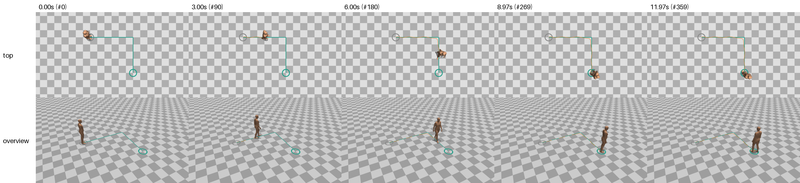
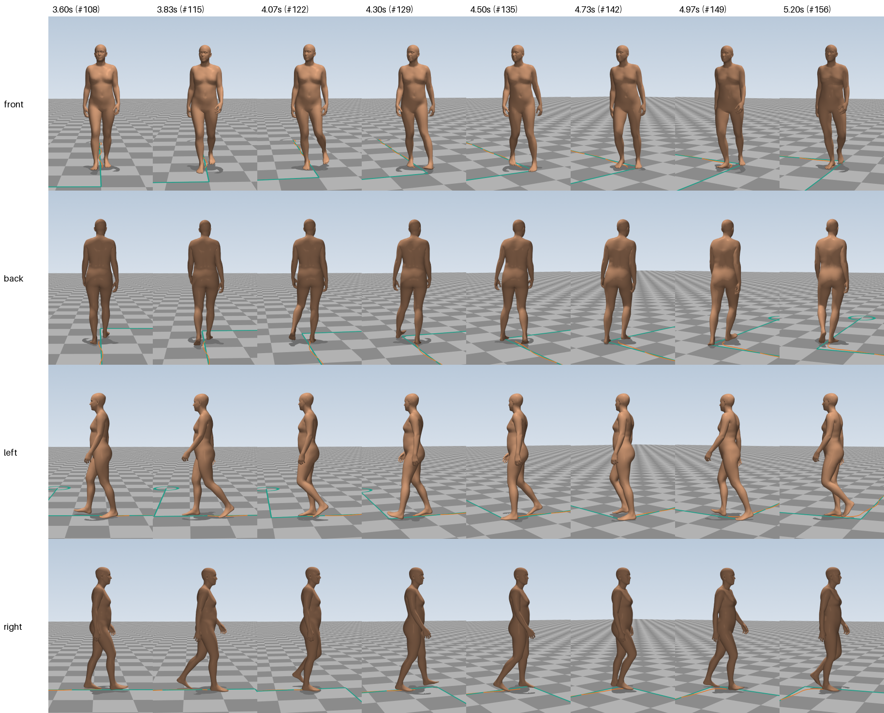
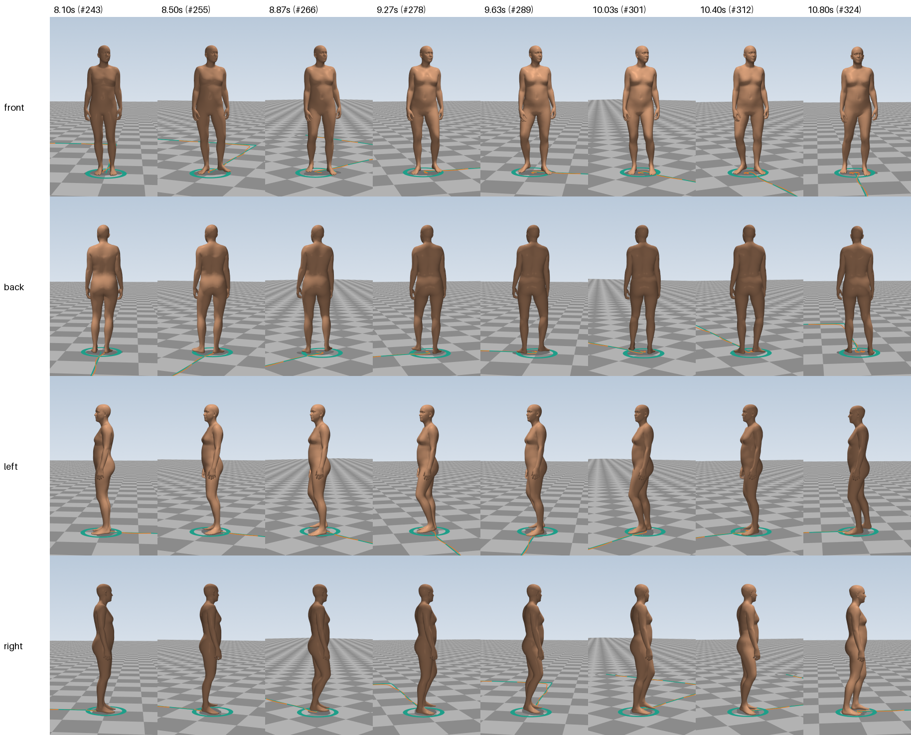

# E03: Start, turn a corner, stop, and turn around on the spot

> **Summary.** The person now has to start from standing, walk 3 m, turn a sharp 90° corner, walk 2.5 m, stop on a marked spot, turn around on the spot and stand still. E02's program could do none of these: it could only walk continuously along smooth curves. The agent redesigned the program around a new idea: **first plan every footstep, then let a simple balance model work out how the body moves over those feet**. With that, starting, stopping, a step turn at the corner and six small turning steps on the spot all come out of one framework. All 15 measurement targets are met on the new task, and both earlier tasks still meet all of theirs. The session was interrupted once by the account's usage limit and resumed. It took 69 minutes of working time and $21.74, the most expensive experiment so far.

| | |
|---|---|
| **Experiment ID** | `E03-turns` |
| **Date** | 2026-11-02 (started 2026-11-01 late evening) |
| **Task** | Stand, start walking, 90° right corner, stop at a marked spot, turn 180° on the spot, stand; 12 s ([`tasks/turns.json`](../../tasks/turns.json)) |
| **Agent** | Claude Code, model Claude Opus 5.5, headless |
| **Started from** | the code of [E02](E02-curved-path.md) |
| **Tools the agent had** | `evaluate.py` (used 15 times), `preview.py` (used 5 of 8 allowed) |
| **Session** | 69 min of working time in two parts (interrupted once by the account usage limit), 170 turns, $21.74 |
| **Result** | 15/15 targets met on the new task; 11/11 on each earlier task; 4 s to compute the 12 s clip |
| **Folder** | [`runs/E03-turns/`](../../runs/E03-turns/) |
| **Main video** | [`runs/E03-turns/videos/grid.mp4`](../../runs/E03-turns/videos/grid.mp4) |

## 1. Why this experiment

Real tasks start and end with the person standing, and real routes have corners. E02's program moved the person continuously along a smooth line at walking speed. It had no notion of standing, starting or stopping, and its own tests showed that a 90° corner made the ankle twist and the foot slide. This experiment asks for all the missing pieces at once:

- **starting from standing:** weight shift, a short first step, accelerating;
- **a sharp corner:** a dedicated turning step, not a gradual curve;
- **stopping exactly on a mark:** shortening steps, bringing the feet together;
- **turning on the spot:** small stepping turns with almost no forward movement.

Unlike the earlier tasks, this motion is not a repeating cycle. Every step is different.

## 2. The task

The person stands still at the start, facing +Z, then starts walking forward. After 3 m they turn 90° to the right at the corner of the marked path and walk 2.5 m to the end of the path, where they stop. Then they turn around on the spot (180°) to face back the way they came, and stand still until the end of the 12-second clip (360 frames).

The pelvis must stay within 30 cm of the path; the larger tolerance than in E02 allows the corner to be rounded off, as people do. The end position and facing direction are checked, and so is that the person really stands still at the start and at the end. The full prompt is in [`runs/E03-turns/TASK.md`](../../runs/E03-turns/TASK.md). The program must also still produce the straight walk and the S-path.

## 3. What the agent did

**The session.** Working time is counted without the 12½-hour break caused by the usage limit:

| Working time | What happened |
|---|---|
| 0–19 min | Read the task and E02's code and notes, measured E02's motions as a baseline, and planned. It decided that E02's design (move the pelvis along the path, then place feet) cannot express standing, starting or stepping on the spot, and that the program had to be turned around. |
| 19–29 min | Wrote the new core modules: the footstep planner and the balance model. |
| 29 min | **Interrupted:** the account's 5-hour usage limit was reached (at 00:41 at night). The session was resumed the next day at 13:06, in the same conversation. |
| 30–31 min | Finished the remaining modules and the main program. |
| 31–52 min | Found and fixed problems through its own numerical checks. At the corner the legs crossed, the ankle bent to 63° with the leg over-stretched, and joints rotated at over 1300°/s. At heel strike the knee snapped straight. In the turn on the spot the heels collided. |
| 52–66 min | Looked at five previews: the corner, the start, the stop and turn, and two closer looks. The corner preview showed the feet passing too close to each other right after the corner, so it added a rule that swings the moving foot wider when needed. It also ran its whole set of test tasks. |
| 66–69 min | Wrote the notes. |

**The new design, in plain words.** The agent's full account is in [`NOTES.md`](../../runs/E03-turns/NOTES.md).

1. **Plan the footsteps first.** A planner strings together behaviours (*stand*, *wait*, *walk along the path*, *stop*, *turn on the spot*) and turns them into a list of footsteps: where each foot goes down, pointing which way, and when.
   - **Starting:** after 0.8 s of standing, the weight shifts onto the left foot for 0.3 s, then the right foot makes a short first step (60 % of a normal step). The next steps grow to full length.
   - **Stopping:** the last two steps shorten (90 % and 70 %), then a closing step brings the trailing foot beside the other one.
   - **The corner** is taken as a **step turn**, the more common and stable of the two ways people turn sharp corners. The outer (left) foot is placed exactly at the corner, slightly outside it and pointing 50° into the turn. The body swings round over it, the inner foot steps into the new direction, and the outer foot pivots on its ball as it pushes off. The step lengths before the corner are adjusted so that the outer foot lands exactly at the corner. An earlier attempt with footsteps along a rounded line put the outer foot inside the corner and crossed the legs.
   - **Turning around on the spot:** six small steps of 60° each, left foot first, alternating, about 0.43 s each. The heels stay close together while the toes open into a V. The agent first tried four steps of 90° and found that they needed an extreme hip rotation and made the feet nearly touch.
2. **Let balance move the body.** Under the feet, the agent tracks where the body's weight presses on the floor (it moves from heel to toes during each step, and from one foot to the other when both are down). The body's centre of mass is then computed with the **inverted pendulum**, a classic simple balance model: the body behaves like a stick balanced over the point where the weight presses. This one model produces several behaviours that no one had to program separately:
   - the side-to-side sway of walking;
   - the body starting to tip forward half a second before the first step, as in a real start;
   - braking at the stop;
   - the body rounding the corner inside the footprints;
   - small weight shifts while stepping on the spot.
3. **One clock per footstep.** Instead of one clock for the whole walk, each footstep has its own clock, which drives how the foot rolls, how far the heel lifts, how much the knee bends and where the weight sits under the foot. The same machinery therefore handles normal steps, short first steps, stops and turning steps. Every oscillation of walking (hip rotation, arm swing, head bob) is scaled by the size of the current step, so it fades in when starting and fades out when stopping.
4. **Kept from E02:** the foot rolling, the legs computed to reach the pinned feet ([inverse kinematics](../glossary.md#animation-and-the-body-model)), the swing of the free leg, slowing down and leaning in bends, and the head turning first. The head now looks where the body will face about half a second later, so it leads the trunk in corners and in the turn on the spot.
5. **New details:**
   - a forefoot pivot at the corner;
   - the knee of the swinging leg bends more for long steps than for short ones;
   - guards that lift the toes or swing the foot wider when the swinging foot would come too close to the floor or to the other foot;
   - small movements while standing: breathing, slow sway, slightly bent elbows.

**The agent's own generality tests** ([`test_tasks/`](../../runs/E03-turns/test_tasks/), 8 extra tasks): a left corner with a stop, a walker who stops and turns 90°, a zig-zag with two corners plus a stop and a 180° turn, a start from standing into a curve, and the earlier tests. E02's failed 90° corner test now works. All tasks generate in under a second of computing.

## 4. Results

### Videos and images

- **All six views in one video:** [`grid.mp4`](../../runs/E03-turns/videos/grid.mp4)
- Single views (local copies only, re-create with `python -m walkenv.render runs/E03-turns`): `front.mp4`, `back.mp4`, `left.mp4`, `right.mp4`, `top.mp4`, `overview.mp4` in the same folder
- The whole task from above and from the overview camera, at five moments:

- Close-ups from the four follow cameras at the two hardest moments. Besides the standard close-up of the walking part ([`contact_sheet.png`](../../runs/E03-turns/videos/contact_sheet.png), 2.0–3.2 s), we rendered two extra sheets for this experiment:

**The corner** (3.6–5.2 s, [`contact_sheet_corner.png`](../../runs/E03-turns/videos/contact_sheet_corner.png)):

**The turn on the spot** (8.1–10.8 s, [`contact_sheet_turn.png`](../../runs/E03-turns/videos/contact_sheet_turn.png)):

The follow cameras turn with the person. During the turn on the spot the body therefore seems to stay in place while the floor and the path lines rotate behind it. The turn itself is best seen in the top and overview views.

**What happens when** (from the agent's plan):

| Time | What the person does |
|---|---|
| 0–0.8 s | stands still, with slight natural sway and breathing |
| 0.8–1.1 s | shifts the weight onto the left foot and starts to lean forward |
| 1.1 s | lifts the right foot for the first, short step |
| 1.5–3.7 s | four steps growing to about 1.0 m/s, then shortening before the corner |
| 3.8–5.1 s | the corner, as a step turn |
| 5.1–6.7 s | three steps along the second part of the path, slowing down |
| 7.3–7.8 s | closing step: the feet come side by side |
| 8.2–10.7 s | turns 180° to the left on the spot in six small steps; the head turns first |
| 10.7–12 s | stands still, facing back the way it came |

### Measurements

**This task:**

| | Measurement | Value | Target |
|---|---|---|---|
| ✅ | Deepest sinking into the floor | 4.12 mm | ≤ 10 mm |
| ✅ | Frames sinking more than 1 cm | 0 frames | 0 |
| ✅ | Frames with nothing on the floor | 0 frames | 0 |
| ✅ | Typical speed of floor-touching skin | 0.15 cm/s | ≤ 1 cm/s |
| ✅ | Speed of floor-touching skin, 95th percentile | 1.29 cm/s | ≤ 3 cm/s |
|  | Distance travelled by the pelvis | 5.63 m |  |
|  | Average speed | 0.47 m/s |  |
| ✅ | Average distance from the path | 2.93 cm | ≤ 30 cm |
| ✅ | Largest distance from the path | 12.03 cm | ≤ 30 cm |
| ✅ | Start position error | 0.58 cm | ≤ 15 cm |
| ✅ | Start heading error | 0 ° | ≤ 15° |
| ✅ | Pelvis speed while standing at the start | 3.28 cm/s | ≤ 10 cm/s |
| ✅ | End position error | 0.22 cm | ≤ 15 cm |
| ✅ | End heading error | 0 ° | ≤ 15° |
| ✅ | Pelvis speed while standing at the end | 1.73 cm/s | ≤ 10 cm/s |
| ✅ | Fastest joint rotation | 464.77 °/s | ≤ 800 °/s |
| ✅ | Frames with a pop | 0 frames | 0 |

**Earlier tasks:** the straight walk and the S-path both still meet 11 of 11 targets, with values practically identical to E02's (for example 2.75 and 2.81 mm deepest sinking, 0.42 and 0.44 cm/s typical skin speed).

**Reading:**

- The person ends **2 mm** from the marked end point and faces exactly the required direction. The stop is precise because the planner adjusts the step lengths so that the feet arrive exactly at the corner and at the end.
- At the corner the pelvis passes 12 cm inside the drawn corner, which is the natural corner-cutting real walkers do, well within the 30 cm tolerance.
- The feet stay planted even through the corner and the turn on the spot (typical skin speed 0.15 cm/s). The 95th-percentile value of 1.29 cm/s comes mostly from the deliberate pivot on the ball of the foot at the corner.
- The average speed of 0.47 m/s includes the standing and turning time. While actually walking the person reaches about 1.0 m/s; on a 3 m stretch from standing they never reach full walking speed, which is realistic.

We checked the agent's numbers independently. Our own run of the measurements gives the same values, `make_motion.py` regenerates the motions bit for bit, and it computes the 12-second clip in 4.0 s of wall-clock time.

### What we see

This assessment is based on still frames from the videos (the three sheets above). The moving video should be watched to confirm it, especially for timing.

- **The whole task is carried out as asked.** In the top view, the orange trail leaves the grey start ring, rounds the corner slightly inside the drawn corner, and ends inside the teal end ring, where the person ends up facing back towards the corner.
- **Standing looks natural:** arms hang relaxed with slightly bent elbows, the weight is on both feet, and the posture is upright.
- **At the corner, the head turns into the turn first.** From 4.0 to 4.5 s the face turns to the person's right, towards the new direction, while the body is still facing forward. The feet are placed for the turn and the body follows within about a step.
- **The turn on the spot is a sequence of small steps,** one foot lifting at a time while the other stays planted, with the feet staying within the end ring. The head again turns first (around 9.3–9.6 s).
- **To check in the video:**
  - whether the turn on the spot looks too regular (the agent's own concern: six identical steps with identical timing);
  - whether the arms look too still during that turn;
  - whether the big foot angles at the corner (about 35–38° relative to the hips, for a moment) are noticeable;
  - how natural the first step from standing looks, around 0.8–1.5 s.

## 5. Problems and limitations

The agent's own list, in plain words:

- **Corner details:** in the step turn, the feet land at quite large angles relative to the hips (about 35–38°) for a brief moment. The pivot on the ball of the foot makes the skin under it move a little.
- **The turn on the spot is regular:** six identical steps with identical timing look slightly mechanical, the arms hang still during the turn, and the final stance has the feet about 8 cm apart front to back.
- **The balance model is simple:** the body is treated as a single point at constant height, so the subtle push people make just before the first step is not modelled. The forward speed varies more within each step than before (±0.15 m/s), and push-off is a little stronger.
- **Timing is not fitted to the clip:** if a task needs more time than the clip has, the motion is simply cut off (with a warning). Here the person finishes early and stands for 1.3 s at the end.
- **No obstacle avoidance yet:** the program warns if a task contains obstacles.
- **Inherited:** gait curves tuned from memory, a possibly abrupt heel contact, and self-contact checked only between feet and leg axes.

**About the cost:** $15.62 of the $21.74 was spent in the second part of the session, after the interruption. (This page first said $27.87 in total, because our summary tool counted the first part twice. Corrected on 2026-11-04.) The second part was also the longer one (40 of the 69 minutes), with many rounds of fixing the corner and the turn, and every turn re-reads the whole, by then very long, conversation.

## 6. Conclusion and next step

This was the hardest step so far, and the agent made it by changing the architecture rather than patching the old one: from "move the body along a line" to "plan the footsteps, then let balance move the body". This is the same split used in robotics and in footstep-based character animation, and the agent arrived at it from first principles. The inverted-pendulum balance model is the key: one simple physical rule produces the starting lean, the braking, the corner cutting and the side-to-side sway, instead of each being tuned by hand. The resulting program handles straight walking, curves, corners, starting, stopping and turning on the spot from a task file, in under a second of computing.

**Next:** [E04](E04-narrow-passage.md) adds obstacles. The person must squeeze sideways through a gap narrower than the shoulders. The agent's notes already point the way: it suggests writing new behaviours, such as a side-step, as new planner steps.

## Files in the experiment folder

| File | Content |
|---|---|
| [`TASK.md`](../../runs/E03-turns/TASK.md), [`CLAUDE.md`](../../runs/E03-turns/CLAUDE.md) | exactly what the agent was told |
| [`make_motion.py`](../../runs/E03-turns/make_motion.py), [`locomotion/`](../../runs/E03-turns/locomotion/) | the agent's program and library |
| [`analyze.py`](../../runs/E03-turns/analyze.py), [`tools/`](../../runs/E03-turns/tools/) | the agent's own checking tools |
| [`test_tasks/`](../../runs/E03-turns/test_tasks/) | extra tasks the agent used to test generality |
| [`NOTES.md`](../../runs/E03-turns/NOTES.md) | the agent's own account |
| `motion.npz`, `motion_straight-walk.npz`, `motion_curved-path.npz` | the motions for this task and the two earlier tasks |
| [`motion.metrics.json`](../../runs/E03-turns/motion.metrics.json) | the measurements |
| `previous/E02-curved-path/` | the starting code it was given |
| `transcript.jsonl`, [`run_summary.json`](../../runs/E03-turns/run_summary.json), [`run.json`](../../runs/E03-turns/run.json) | the full session log (both parts), its key facts, and the record of the interruption |
| `videos/` | rendered videos and images, including two extra close-up sheets, `contact_sheet_corner.png` and `contact_sheet_turn.png` |
