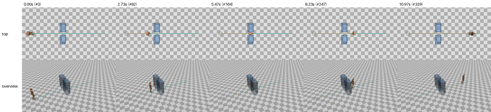
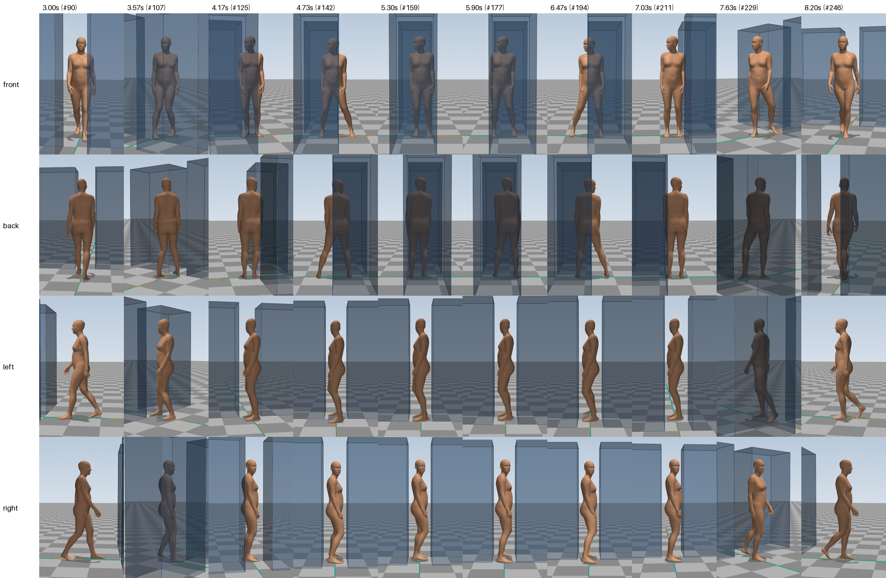

# E04: Squeezing sideways through a narrow gap

> **Summary.** The person walks towards two tall cabinets with only a 0.40 m gap between them. The gap is narrower than the person's shoulders, so they have to turn sideways and side-step through. Starting from E03's program, the agent added obstacle handling. The program now finds narrow passages along the path, slows the person down, turns them sideways with a step turn, side-steps them through the gap and turns them back into walking. The body passes with **3.9 cm and 4.3 cm** to spare on either side and never touches a cabinet. All 15 measurement targets are met, and all three earlier tasks still meet all of theirs. The agent also added a second technique for slightly wider gaps (turning only the shoulders while walking) and tested both on ten gap variants of its own. The session was interrupted twice by the account's usage limit. It took 58 minutes of working time and $35.21, the most expensive experiment so far, partly because of the resumes.

| | |
|---|---|
| **Experiment ID** | `E04-narrow-passage` |
| **Date** | 2026-11-02 to 2026-11-03 |
| **Task** | Walk forward, get through a 0.40 m wide, 0.6 m deep gap between two cabinets without touching them, walk on; 11 s ([`tasks/narrow-passage.json`](../../tasks/narrow-passage.json)) |
| **Agent** | Claude Code, model Claude Opus 5.5, headless |
| **Started from** | the code of [E03](E03-turns.md) |
| **Tools the agent had** | `evaluate.py` (used 19 times), `preview.py` (used 6 of 8 allowed) |
| **Session** | 58 min of working time in three parts (interrupted twice by the account usage limit), 156 turns, $35.21 |
| **Result** | 15/15 targets met; 3.9 / 4.3 cm clearance to the cabinets; all three earlier tasks still meet all targets; 8 s to compute the 11 s clip |
| **Folder** | [`runs/E04-narrow-passage/`](../../runs/E04-narrow-passage/) |
| **Main video** | [`runs/E04-narrow-passage/videos/grid.mp4`](../../runs/E04-narrow-passage/videos/grid.mp4) |

## 1. Why this experiment

So far the person only had to follow a line on an empty floor. Real environments have furniture, and moving through them sometimes needs a completely different way of moving. A gap narrower than the shoulders is a clear example: walking forward is impossible, and a person turns sideways and shuffles through. This experiment tests whether the program can:

- **see obstacles:** it now has to reason about where the boxes are and how much room the body needs;
- **switch to a different kind of movement** (side-stepping) and back;
- **stay clear of the obstacles,** measured on the body's skin.

## 2. The task

The person is already walking along a straight line. About 4 m ahead stand two tall cabinets, 2 m high, with a gap of 0.40 m between them. The gap is 0.6 m deep, from z = 4.0 to z = 4.6 m. The person has to get through without touching either cabinet, then continue walking normally. The clip is 11 seconds (330 frames), and the pelvis has to stay within 15 cm of the straight path.

**How tight is it?** With the arms hanging down, the body is 0.41 m wide at the shoulders (0.55 m including the arms) and 0.38 m wide at the hips, but only 0.29 m deep from belly to back. Walking straight in, the body would go about 8 cm into each cabinet; the agent measured this first. Fully sideways, about 5 cm remain on each side.

The full prompt is in [`runs/E04-narrow-passage/TASK.md`](../../runs/E04-narrow-passage/TASK.md). The program must also still handle the straight walk, the S-path and the turning task.

## 3. What the agent did

**The session.** Working time is counted without the breaks caused by the usage limit:

| Working time | What happened |
|---|---|
| 0–7 min | Read the task and E03's code and notes, copied E03's library into its folder, and measured the starting point, including walking straight into the cabinets. **Interrupted** by the usage limit (13:54); resumed at 18:02. |
| 7–16 min | Planned the passage behaviour. |
| 16–17 min | Wrote the new obstacle module and the passage steps in the footstep planner. |
| 17–47 min | Built measuring tools and tuned the clearances (see below). Fixed problems it found: feet sliding while pivoting, a toe dipping into the floor on the first step out, the trailing knee snapping straight because the foot was briefly out of reach, and side steps that were too fast. |
| 35–54 min | Six previews (the entry, the side steps, the turn into the gap, the exit, and a test gap of 0.60 m), and ten extra gap tasks of its own. **Interrupted** again (18:49), shortly after the final motion was written. |
| 54–58 min | Resumed the next day (13:04): final checks and the notes. |

**What the person does** (from the agent's plan):

| Time | What happens |
|---|---|
| 0–2.5 s | walks along the path at about 1.2 m/s; the head is already turned towards the gap |
| 2.5–3.1 s | the last two steps get shorter and the person slows down |
| 3.1–3.5 s | **entry step:** the right foot lands about 15 cm before the gap, turned 60° to the left; the upper body leads and the body turns over this foot |
| 3.65–4.07 s | the left foot comes round behind and is put down sideways; the person now faces the left cabinet, turned 90° from the walking direction, and pauses for an instant |
| 4.2–7.1 s | **three side-step cycles:** the right foot steps about 0.3 m sideways along the path, the left foot closes up. Knees slightly bent, trunk upright, arms close to the body, head turned about 60° to look where the body is going |
| 7.2–7.55 s | **exit step:** the right foot steps out past the gap, turned back towards the walking direction, and the body turns back over it |
| 7.6–8.05 s | the left foot swings forward into the first walking step |
| 8.1–11 s | walking resumes, steps and arm swing grow back to normal, and the person reaches 1.2 m/s again at about 9.2 s |

**How the program works now**, in plain words (the agent's full account is in [`NOTES.md`](../../runs/E04-narrow-passage/NOTES.md)):

1. **Finding gaps.** Every centimetre along the path, the program measures how much free room there is to the left and right, up to the nearest box. Where the room is narrower than the walking body plus a margin (0.63 m), it marks a **passage**, then decides how to get through:
   - **Shoulder turn** for gaps of roughly 0.58–0.63 m: keep walking, hold the arms still and close, and turn the shoulders just enough. The angle is computed from a simple model of the body seen from above.
   - **Fully sideways** for narrower gaps, such as this task's 0.40 m.
   - Gaps narrower than the body's depth are reported as impossible.
2. **Fitting the side steps into the footstep plan.** The walk is split into stretches before, through and after the passage. The steps before the passage are adjusted so that the leading foot lands exactly at the entry point, and the steps after it start short and grow, so the person speeds up gradually. In the gap, the feet alternate between a narrow stance (20 cm apart) and a wider one, in three equal side steps with small deliberate variations in length and timing.
3. **Turning in and out** reuses E03's step turn: the body turns over the leading foot, and the trailing foot comes round. The angles were chosen so that the hips never have to twist more than about 35°, and feet never pivot on the floor in the passage, so they cannot slide.
4. **New types of foot movement.** A side step lifts the foot nearly flat, moves it sideways only once it is off the floor, and stops it before it lands, so the sole never skims the floor. The existing machinery (balance model, pelvis height, legs) works on these steps unchanged.
5. **Upper body.** In the gap the trunk stays upright, the arms hang closer to the body, and the head looks along the direction of travel rather than at the cabinet in front.
6. **The balance model from E03** produces the slowing down into the gap, the brief pause while turning sideways, the stop-and-go of side-stepping and the speeding up afterwards, without separate tuning.

**Measuring what it could not see.** The agent's code has no access to the body's skin, only to the joints, so it cannot compute clearances to the cabinets itself; only `evaluate.py` can. That tool gives one number for the whole clip, so the agent built ways around this:

- **Time windows:** to measure only part of the motion, it moved all frames outside a chosen time window 50 m away and measured the rest.
- **Slices:** it cut the cabinets into slices 10 cm deep or 20 cm high, in task files of its own, so each slice reported its own clearance and showed where the body comes closest.
- **Zoom:** it wrote a small PNG reader to enlarge parts of the preview images.

This showed that the sideways phase is the tightest (belly in front, buttocks behind, at hip height), so it centred the body precisely there, 8.5 mm in front of the middle of the gap.

**The agent's own generality tests** (ten new gap tasks in [`test_tasks/`](../../runs/E04-narrow-passage/test_tasks/)), all with every target met:

- a gap right after the start;
- a gap 8 cm off the path;
- a gap after a 30° bend, with the cabinets turned;
- two gaps in a row;
- a standing start, a gap and a stop;
- gaps of 0.50 and 0.55 m (sideways);
- gaps of 0.58–0.62 m (shoulder turn).

## 4. Results

### Videos and images

- **All six views in one video:** [`grid.mp4`](../../runs/E04-narrow-passage/videos/grid.mp4)
- Single views (local copies only, re-create with `python -m walkenv.render runs/E04-narrow-passage`): `front.mp4`, `back.mp4`, `left.mp4`, `right.mp4`, `top.mp4`, `overview.mp4` in the same folder
- The whole task from above and from the overview camera, at five moments:

- **The squeeze,** from turning in to walking out (3.0–8.2 s), from the four follow cameras ([`contact_sheet_squeeze.png`](../../runs/E04-narrow-passage/videos/contact_sheet_squeeze.png), rendered for this report; the standard close-up of the walking part is [`contact_sheet.png`](../../runs/E04-narrow-passage/videos/contact_sheet.png)):

How to read the squeeze sheet:

- The follow cameras turn with the person. While the person stands sideways in the gap, "front" and "back" look at them *through* a cabinet, which is why the body looks darker in those rows. The cabinets are drawn see-through on purpose, so they never hide the body.
- The **left and right rows** look *along* the gap, and show best how the body fits between the two cabinets.

### Measurements

**This task:**

| | Measurement | Value | Target |
|---|---|---|---|
| ✅ | Deepest sinking into the floor | 4.05 mm | ≤ 10 mm |
| ✅ | Frames sinking more than 1 cm | 0 frames | 0 |
| ✅ | Frames with nothing on the floor | 0 frames | 0 |
| ✅ | Typical speed of floor-touching skin | 0.29 cm/s | ≤ 1 cm/s |
| ✅ | Speed of floor-touching skin, 95th percentile | 1.43 cm/s | ≤ 3 cm/s |
|  | Distance travelled by the pelvis | 8.44 m |  |
|  | Average speed | 0.77 m/s |  |
| ✅ | Average distance from the path | 1.7 cm | ≤ 15 cm |
| ✅ | Largest distance from the path | 4.32 cm | ≤ 15 cm |
| ✅ | Start position error | 2.12 cm | ≤ 15 cm |
| ✅ | Start heading error | 1 ° | ≤ 15° |
| ✅ | Closest approach to the left cabinet | 3.88 cm | > 0 cm |
| ✅ | Frames touching the left cabinet | 0 frames | 0 |
| ✅ | Closest approach to the right cabinet | 4.27 cm | > 0 cm |
| ✅ | Frames touching the right cabinet | 0 frames | 0 |
| ✅ | Fastest joint rotation | 452.01 °/s | ≤ 800 °/s |
| ✅ | Frames with a pop | 0 frames | 0 |

**Earlier tasks:** the turning task meets 15 of 15 targets, and the S-path and the straight walk 11 of 11 each. The S-path and the straight walk give exactly the same numbers as in E03. The turning task changed slightly (fastest joint 465 → 445 °/s) because a new rule, that a swinging leg must always be able to reach its foot, also applies to the turning steps.

**Reading:**

- **The squeeze works with real margins:** the skin never comes closer than 3.9 cm to the left cabinet and 4.3 cm to the right one. With about 5 cm per side available when fully sideways, the body is close to perfectly centred.
- **The feet stay planted** through the turning in and out and the side steps (typical skin speed 0.29 cm/s), because the plan avoids pivoting feet in the passage.
- **The path is held within 4.3 cm,** even through the sideways part.
- **The average speed** of 0.77 m/s includes the slow passage (about 0.3 m/s while side-stepping, about 5 s in total for slowing down, passing and speeding up again).

We checked the agent's numbers independently. Our own run of the measurements gives the same values on all four tasks, and `make_motion.py` regenerates the motions bit for bit. It computes the 11-second clip in 8.0 s of wall-clock time. That is within the requirement but slower than before; the agent reports 2.2 s of actual computing plus about 3 s of Python start-up, and our measurement includes some variation from the machine.

### What we see

This assessment is based on still frames from the videos (the two sheets above). The moving video should be watched to confirm it.

- **The task is carried out as asked.** From above, the person walks up to the cabinets, crosses the gap turned sideways (5.5 s), and walks on along the path.
- **The body fits the gap visibly.** In the left and right rows (looking along the gap) the person stands upright between the two cabinets, with a small space in front of the belly and behind the back, from 4.2 to 7.0 s.
- **The person looks where they are going.** While standing sideways, the head is turned towards the direction of travel. In the right row, the face turns towards the camera, which is placed ahead of the person in that direction.
- **Side-stepping is recognisable:** the feet alternate between apart (4.7 s, 6.5 s) and together (5.3 s, 5.9 s), with slightly bent knees and arms held close to the body.
- **Turning in and out:** at 3.6 s the body is turning over the leading foot as the trailing leg comes round; at 7.6 s it turns back, and by 8.2 s the person is walking normally again.
- **To check in the video:**
  - whether the side-stepping rhythm looks too even (the agent's own concern);
  - whether the quick 60° turns on the entry and exit steps look natural;
  - whether the still arms during the squeeze look stiff;
  - the one frame at the exit where the toes skim the floor (around 7.2–7.5 s).

## 5. Problems and limitations

The agent's own list, in plain words:

- **Side-stepping is regular.** Apart from small variations the rhythm is even, and the body almost stops at each closing step. This is physically consistent, but may look slightly mechanical. The arms hang still, whereas a real person might hold them in front or brush a cabinet with a hand.
- **The turns in and out are quick:** the body turns 60° in about half a second on the entry and exit steps, with up to about 35° of hip twist. When the right foot leaves its turned position at the exit, its toes skim the floor for one frame.
- **The clearance model was calibrated on this body.** The program cannot see the skin, so the body widths it plans with were tuned with `evaluate.py`; a different body shape would need new values. The planner does not check the finished motion against the obstacles itself.
- **Only gaps across the path are handled.** Obstacles in the way of the path, obstacles that leave room on one side only, and low boxes that could be stepped over are reported but not avoided. The shoulder-turn mode does not slow the person down, which real people usually do.
- **Inherited:** gait curves tuned from memory, a possibly abrupt heel contact, self-contact checked only between legs and feet, and the balance model treating the body as a single point.

**About the cost.** Of the $35.21:

| Part | Working time | Cost | What happened |
|---|---|---|---|
| 1 | 7 min | $1.95 | reading and measuring, then the limit |
| 2 | 47 min | $14.45 | building and tuning |
| 3 | 4 min | $18.80 | final checks and notes |

The last part was expensive because resuming a long conversation after many hours means the whole conversation (about 424,000 tokens) has to be read in again at full price, rather than from the cheaper short-term cache. Interruptions late in a session are therefore costly.

## 6. Conclusion and next step

The footstep-plus-balance design from E03 proved its value: an entirely new way of moving (turning sideways and side-stepping) fitted in as new kinds of footsteps, while everything after the plan (balance, legs, upper body) worked unchanged. All four tasks now run from one library and one command, each in a few seconds. The agent also showed it can work around the limits of its tools: it turned a whole-clip measurement into time-window and slice measurements to find exactly where the body comes closest.

**With E04 the planned series is complete.** The library now handles straight walking, smooth curves, sharp corners, starting, stopping, turning on the spot and narrow gaps. The natural next step is a **combined scene**: a room with furniture and an instruction in words, to test whether the accumulated program can follow a new, mixed instruction quickly. Before that, the videos of E01–E04 should be watched by people, to check the points the measurements cannot capture (listed under "What we see" on each page).

## Files in the experiment folder

| File | Content |
|---|---|
| [`TASK.md`](../../runs/E04-narrow-passage/TASK.md), [`CLAUDE.md`](../../runs/E04-narrow-passage/CLAUDE.md) | exactly what the agent was told |
| [`make_motion.py`](../../runs/E04-narrow-passage/make_motion.py), [`locomotion/`](../../runs/E04-narrow-passage/locomotion/) | the agent's program and library (new module: [`obstacles.py`](../../runs/E04-narrow-passage/locomotion/obstacles.py)) |
| [`analyze.py`](../../runs/E04-narrow-passage/analyze.py), [`tools/`](../../runs/E04-narrow-passage/tools/) | the agent's own checking tools (time windows, slices, zoom, batch evaluation) |
| [`test_tasks/`](../../runs/E04-narrow-passage/test_tasks/) | extra tasks the agent used to test generality, including ten gap variants |
| [`NOTES.md`](../../runs/E04-narrow-passage/NOTES.md) | the agent's own account |
| `motion.npz`, `motion_turns.npz`, `motion_curved-path.npz`, `motion_straight-walk.npz` | the motions for this task and the three earlier tasks |
| [`motion.metrics.json`](../../runs/E04-narrow-passage/motion.metrics.json) | the measurements |
| `previous/E03-turns/` | the starting code it was given |
| `transcript.jsonl`, [`run_summary.json`](../../runs/E04-narrow-passage/run_summary.json), [`run.json`](../../runs/E04-narrow-passage/run.json) | the full session log (all three parts), its key facts, and the record of the interruptions |
| `videos/` | rendered videos and images, including the extra close-up `contact_sheet_squeeze.png` |
