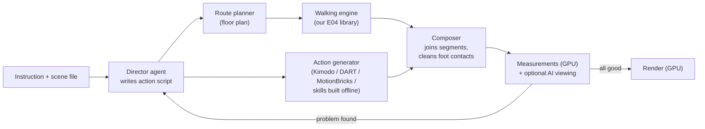

# P01: Fast, high-quality motion generation: research directions

> **Summary.** In our four experiments, teaching the agent a *new kind* of movement took 38–69 minutes and cost $6.52–21.74. Using a movement it already knows, on a new task, takes 4–8 seconds. Speed is therefore not a problem of computing motion. It is a problem of how often the agent has to invent something new while we wait.
>
> The target ("go to the kitchen, grab a pan, put it on the stove, break an egg, cook the egg" in under 10 minutes, objects left out for now) is reachable if we split the work into two phases:
>
> - **Building capabilities** happens offline: hours, but once.
> - **Carrying out a task** happens online: minutes, every time.
>
> In the online phase the agent no longer writes motion code. It acts as a **director** that writes a short action script using a fixed set of skills.
>
> The skills missing for the kitchen task (reaching at different heights, bending and crouching, a carrying posture, working at the counter) can come from three places:
>
> - **pretrained motion models:** in 2026 NVIDIA released three that fit our problem unusually well (Kimodo, ARDY and MotionBricks);
> - **motion-capture datasets** that include kitchen activities;
> - **skills the agent builds offline,** as it did in E01–E04.
>
> A GPU such as the NVIDIA L4 is needed for the pretrained models, and it makes rendering and measuring several times faster. We recommend a hybrid "director plus fast motion engine" design and seven steps to get there, starting with the low-risk ones.

| | |
|---|---|
| **Proposal ID** | `P01-fast-generation` |
| **Date** | 2026-11-03 |
| **Status** | For discussion. No experiments run yet; all times for the new design are estimates, marked as such. |
| **Question** | How can complex everyday movement be generated in under 10 minutes without losing the quality reached in E01–E04? |
| **Allowed** | Everything: classical algorithms, existing datasets, pretrained models, a stronger GPU (for example an NVIDIA L4), and agents in any role |
| **First target** | All movement of the kitchen task except handling objects |

**A note on the research question.** E01–E04 tested what an agent can do with its own knowledge only. This proposal deliberately opens the door to data and pretrained models, because the goal is now a fast, high-quality pipeline. Both lines can continue side by side. Experiments that use data will be labelled as such, so that the "knowledge only" results stay clean.

---

## 1. What the kitchen task needs

**The movements involved, and whether we already have them:**

| Part of the task | Movement needed | Do we have it? |
|---|---|---|
| Walk to the kitchen, through doors and around furniture | Planning a route on the floor plan, then walking, corners, narrow gaps, starting, stopping | Walking: **yes** (E01–E04). Route planning on a floor plan: **no**, but this is a standard, quick algorithm. |
| Stop at the cupboard and reach for the pan | Reaching with one or both arms at different heights, crouching for a low shelf, rising onto the toes for a high one | **no** |
| Carry the pan to the stove | Walking with the arms held in front of the body | **partly:** walking yes, the arm posture on top of it no |
| Put the pan on the stove | Reaching forward at counter height and placing | **no** |
| Break an egg | A two-handed movement in front of the chest, looking at the hands | **no** |
| Cook the egg | Standing at the stove: stirring, shifting weight, looking at the pan, waiting naturally | **no** |
| Throughout | Looking at things (gaze), standing naturally between actions | **partly** |

So the task needs roughly **5–7 new kinds of movement**. The grasping and the objects themselves come later.

**A possible time budget for one task** (estimates for the proposed design):

| Step | Target time |
|---|---|
| Read the instruction and the scene, plan the actions | 1–2 min |
| Plan the routes, generate the walking | under 10 s |
| Generate the action segments (reach, crouch, crack an egg...) | under 1 min |
| Join everything, clean up the foot contacts | under 30 s |
| Measure; fix automatically if needed (1–2 rounds) | 1–3 min |
| Render the videos | about 1 min |
| **Total** | **about 4–8 min** |

---

## 2. Where time and money go today (measured)

There are two very different costs in our pipeline:

| | What it is | Measured |
|---|---|---|
| **Building a capability** | The agent writes or extends the motion program for a new kind of movement (one session) | E01 61 min / $12.71, E02 38 min / $6.52, E03 69 min / $21.74, E04 58 min / $18.80 |
| **Using a capability** | The finished program generates a clip for a new task of a known kind | 4–8 s for 10–12 s of motion on the laptop CPU (including about 3 s of Python start-up) |
| **Rendering** | Six camera videos plus images | about 3–4 min per clip on the laptop CPU |
| **Measuring** | `evaluate.py` on the real body mesh | about 30 s per clip |

Inside the agent sessions, the time goes into the model's own work, not into running code. In E01:

- **78 % of the hour** was the model thinking and writing (2,881 of 3,682 s);
- **72 % of everything it wrote** was hidden reasoning (218,000 tokens);
- **16.8 million tokens** of conversation were re-read over 75 steps.

In E03 and E04, long sessions and resumes after usage-limit interruptions drove the cost.

**What this means for the target.** With today's way of working, the kitchen task would need 5–7 new capabilities. At our measured rate that is roughly 5–7 hours and $75–150 of agent work, the opposite of 10 minutes. Two rules follow:

1. **Never build capabilities while someone waits for a task.** Build them in advance.
2. **Get capabilities faster and cheaper, or from elsewhere:** from data and pretrained models, not only from the agent's own code.

---

## 3. Your two ideas

### 3.1 "Reuse what the agents already generated, but then unseen movement is still slow?"

We already reuse it in the strongest possible form. The agent did not produce a pile of clips, it produced a **generator**: a program that makes any walking task (any path, corner, stop, turn or gap) in seconds. So "unseen" has two meanings:

- **New combinations of known movements** (a new floor plan, a new route): already fast.
- **New *kinds* of movement** (reaching, crouching, cooking gestures): slow only if the agent has to write them from scratch.

There are three ways around the second case, and they can be combined:

| Source of a new movement | Speed when needed | Quality and control | Cost to set up |
|---|---|---|---|
| **Pretrained motion model** (section 4.B) | seconds | natural movement learned from motion capture; less precise control; may need conversion to our body | integration work, a GPU |
| **Motion-capture data**, through search ("retrieval") or motion matching (4.D, 4.E) | milliseconds to seconds | real human movement; limited to what was recorded | data preparation |
| **Skill built offline by an agent**, as in E01–E04 | seconds, once built | precise, measured, our quality bar | about 1 hour of agent time per skill, once; several can be built in parallel |

A useful addition is a **motion memory**: every segment that passed our checks is kept, labelled and searchable (for example "crack egg at counter height 0.9 m"). A later task can reuse it and adapt it to a new height or position in milliseconds. This is your idea in its most direct form, and it pays off for sub-actions that recur often.

### 3.2 "The agent makes keyframes, NVIDIA MotionBricks fills in the movement between them"

This is a good division of labour. The agent is good at deciding *what* happens, *where* and *when*. A model trained on motion capture is good at *how* a body moves between two poses.

**What MotionBricks is** (NVIDIA, SIGGRAPH 2026):

- **Fast:** a real-time motion model; the paper claims 15,000 frames per second at 2 ms latency.
- **In-betweening:** given the last four poses and one to four target poses, it generates the movement in between. The model chooses the transition length itself, 0.6–1.9 s per call.
- **Navigation:** it also has a walking mode (speed, direction, style).
- **"Smart primitives":** target poses arranged around an object, which fits the kitchen well once objects come in.

**Caveats we found:**

1. **No SMPL-X model.** The trained models are for NVIDIA's own body model, SOMA, and the Unitree G1 robot only. NVIDIA's SOMA framework can convert SMPL-X motion *into* SOMA, but we need the opposite direction too: SOMA output back onto our SMPL-X body. That needs a fitting step we would have to build and test. NVIDIA itself warns that its SMPL-X version of the sibling model Kimodo shows "particularly severe retargeting artifacts". **Conversion quality is the main risk of this route.**
2. **Who writes the keyframes.** An agent writing exact joint angles is slow and error-prone: in E01 it took an hour to get walking right. Better: the agent writes *what the keyframe means*, for example "at 12.4 s, right hand at the upper cupboard handle, 1.6 m high, looking at it". A pose solver turns that into a full-body pose in milliseconds, using inverse kinematics plus a model of natural poses, or a similar pose taken from motion-capture data.
3. **Short transitions:** 0.6–1.9 s per call, so longer actions need several keyframes, or a model that also takes text.
4. **Release status:** I could not confirm a "v0.2". The repository I found lists a G1 preview followed by a SOMA model, with no tagged releases. If you have the v0.2 link, I will check what changed.

**Related alternatives:**

- **Kimodo** (NVIDIA) does the same "keyframes plus model" idea offline, with a text description added: full-body keyframes, hand and foot targets, paths, up to 10 s per generation.
- **ARDY** (NVIDIA) does it in real time, in a streaming fashion.

**Verdict:** worth testing, especially for the action segments (reach, crouch, gestures) and for joining our walking to those actions. It is not needed for the walking itself, which our program already does well.

---

## 4. Research directions

Each direction is described with what it is, why it makes things faster, its effect on quality, the effort, and the risk.

### 4.A Agent as director, not as animator (change of architecture)

**Idea.** During a task, the agent does not write motion code. It reads the instruction and a description of the scene, and writes a short **action script** using a fixed menu of skills. The engine executes the script in seconds. If a measurement fails, the agent changes the script (for example "start the reach 0.3 s later", "stand 10 cm closer"), not the code.

An example action script, for illustration only:

```json
[
  {"do": "walk_to",  "target": "kitchen.cupboard_upper", "stop_facing": "cupboard"},
  {"do": "reach",    "hand": "right", "target": "cupboard_upper.shelf_2", "duration_s": 1.2},
  {"do": "walk_to",  "target": "stove.front", "arms": "carry_two_hands"},
  {"do": "place",    "hands": "both", "target": "stove.burner_front_left"},
  {"do": "gesture",  "name": "crack_egg", "at": "stove.burner_front_left", "duration_s": 2.5},
  {"do": "work_at",  "target": "stove", "activity": "stir", "duration_s": 20, "look_at": "pan"}
]
```

**Why faster.** Planning a script is a short job: a few thousand words of output instead of hours of programming. Estimated with today's prices, it costs about $0.10–0.50 per task with Claude Sonnet 5.5 ($2 / $10 per million input / output tokens), about twice that with Opus 5.5 ($4 / $20), and takes 1–2 minutes. Our experiments cost $6.52–21.74 each.

**Quality.** The same as the skills it uses. The director only decides what happens and where.

**What it needs:**

- a **scene file:** rooms, doors and furniture as boxes, with named places to interact with ("stove.front", "cupboard_upper.shelf_2");
- a short **skill reference** for the agent, instead of making it read the code;
- **classical route planning** on the floor plan.

**Research backing.** Several recent papers use exactly this split, a language model planning the steps and a separate motion system executing them: UniHSI, SIMS (ICCV 2025), "Human-Object Interaction from Human-Level Instructions" (ICCV 2025) and Interplay (ICLR 2026).

**Effort:** low to medium. **Risk:** low. **Recommended first.**

### 4.B Pretrained motion models

These models were trained on large amounts of motion capture. They generate new movement from a text description and/or constraints such as keyframes, hand positions or a path to follow.

| Model | From | What it does | Controls | Body | Speed | Licence | Fit for us |
|---|---|---|---|---|---|---|---|
| **Kimodo** | NVIDIA, March 2026 | Offline generation from text and constraints; trained on about 700 h of motion capture | Text, full-body keyframes, hand and foot targets, path and waypoints; up to 10 s per generation | SOMA (recommended), **SMPL-X variant (with an artifact warning)**, G1 robot | Not published; tested on an L4. About 17 GB of GPU memory, or under 3 GB if the text part runs on the processor | SMPL-X variant: research only. SOMA variants: NVIDIA Open Model License | Strong candidate for the action segments; the SMPL-X quality must be tested |
| **ARDY** | NVIDIA, July 2026 (SOMA version October 2026) | Real-time, streaming version of Kimodo's ideas | Streaming text, waypoints, speed, keyframes, hand and foot targets | Generic, G1, SOMA | The paper reports about 33 ms per generation step | NVIDIA Open Model Agreement | Long, continuous sequences; same conversion issue |
| **MotionBricks** | NVIDIA, SIGGRAPH 2026 | Real-time in-betweening, navigation and "smart primitives" | 1–4 target poses; speed, direction, style | SOMA, G1 | Claimed 2 ms latency | Code Apache-2.0; models NVIDIA Open Model Agreement | Transitions between our walking and actions; later, object interactions |
| **DART** | ETH Zürich, ICLR 2025 | Real-time text-to-motion in short overlapping pieces | Text; spatial goals (reach a point, follow a path) through optimisation or reinforcement learning | **SMPL-X natively** | Real-time; about 10× faster than an earlier comparable method | Check | **No conversion needed;** smaller vocabulary (trained on BABEL labels) |
| **HY-Motion 1.0** | Tencent, December 2025 | Large text-to-motion model (1 billion parameters, or 0.46 billion in "Lite"), over 200 motion categories | Text | To be checked (described as SMPL-H / SMPL-X compatible) | Needs 24–26 GB of GPU memory, so on an L4 only the Lite model | Tencent community licence | Broad vocabulary, less control |

**Common caveats:**

- none of these models knows about the scene (furniture, walls), so we have to give them constraints;
- some produce foot sliding (Kimodo lists this itself, and has a built-in clean-up);
- they do not always do exactly what the text says;
- our measurements and a clean-up step stay essential.

**Effort:** medium (installation, a Linux machine with a GPU, conversion). **Risk:** medium (conversion quality, licences). **Benefit:** the largest gain in *breadth* of movement.

### 4.C Keyframes plus in-betweening

This is your idea from 3.2, as a general method:

1. The agent writes **semantic keyframes**: where the hands, feet, pelvis and gaze must be at certain moments, plus a posture word such as "crouch" or "reach high".
2. A **pose solver** turns each into a full-body pose in milliseconds: inverse kinematics plus a model of natural poses, or the closest pose found in motion-capture data.
3. An **in-betweening** method fills the gaps:
   - MotionBricks (real-time);
   - Kimodo with keyframe constraints (offline, with text guidance);
   - DART with goal optimisation;
   - or, for simple cases, classical smooth curves plus inverse kinematics.

**Effort:** medium. **Risk:** medium (key-pose quality, conversion). Best used for action segments and transitions.

### 4.D Classical techniques: fast, with no training needed

| Technique | What it does | Use for us |
|---|---|---|
| **Route planning** on a grid of the floor plan (A* search plus smoothing) | Finds a short, collision-free route in milliseconds | Getting to the kitchen. Our E04 gap detection already handles narrow doors. |
| **Procedural skills with inverse kinematics** | Reaching, bending, crouching, computed from targets, as our walking is | The agent can write these offline, as in E01–E04, to our quality bar |
| **Motion matching** (standard in games) | Every few frames, searches a motion-capture database for the clip that best continues the current movement and matches the goal | Natural walking variety and idling; real-time; needs a prepared database |
| **Inertialization** (from the game *Gears of War*) | Switches from one motion to another within milliseconds without a visible jump | Joining walking and action segments |
| **Layering** | Lower body from the walking engine, upper body from an action clip, blended | Walking while carrying |
| **Foot-contact clean-up** with inverse kinematics | Pins feet that should be planted | Cleaning the output of pretrained models |

**Effort:** low to medium per technique. **Risk:** low. These are the reliable glue of any fast pipeline.

### 4.E Motion-capture data

| Dataset | Content | Body format | Relevance |
|---|---|---|---|
| **AMASS** | Large collection of many motion-capture datasets, unified | SMPL-X fits available | General movement; licences differ per sub-dataset |
| **BABEL** | Action labels for AMASS | (as AMASS) | Search by action; DART's training data |
| **TRUMANS** | About 15 h of motion in 100 indoor scenes, including kitchens | SMPL-X | Movement among furniture |
| **ParaHome** | Everyday home activities; 207 sequences, 38 people, body and hands, with objects | SMPL-X | Home actions, hands |
| **EPFL-Smart-Kitchen-30** | 29.7 h of cooking: 16 people, 4 recipes, body and hand movement, about 55,000 labelled action segments | Body and hand kinematics (conversion needed) | **Cooking actions such as cracking an egg and stirring**; licence CC BY-NC 4.0 (non-commercial) |
| **HUMOTO** | 735 human–object interaction sequences | Needs conversion to SMPL-X | Later, for objects |
| **BONES-SEED** | 142,220 professional motion-capture clips, open since March 2026 | SOMA, G1 | Search, motion matching, training; same conversion question as the NVIDIA models |

**Uses:**

- searching for a suitable clip ("retrieval") or motion matching;
- fine-tuning or training models;
- a realism reference for scoring our results.

**Licences** are mostly for non-commercial research, which fits a research project. The SMPL-X model itself already has this licence.

### 4.F Our own fast model (longer term)

**Idea.** Train a small generative model on SMPL-X motion. The training data would be motion capture from 4.E plus large amounts of synthetic data from our own walking engine, which comes with perfect labels: routes, footsteps, gaps.

**Benefit:** generation in milliseconds, aware of the scene, on our body, with no conversion, and covering the combinations it has learned.

**Effort:** high (weeks). **Risk:** medium. An L4 is enough to train small models, slowly.

This is the most direct way to turn "what the agents generated" into a fast general model.

### 4.G Physics-based refinement (quality guardrail)

**Idea.** Run the finished motion through a physically simulated character that tries to follow it, for example MaskedMimic in NVIDIA's ProtoMotions framework. Whatever is physically impossible (sliding, sinking, floating) gets corrected or flagged. Other researchers already use MaskedMimic as such a filter.

**Caveat:** the simulator support for SMPL-X is limited.

**Effort:** high. **Risk:** medium. A later step, once the motion sources are fixed.

### 4.H Faster, cheaper agents and the right hardware

**Choose the model by role** (list prices per million input / output tokens):

| Role | Model | Price |
|---|---|---|
| Hard skill-building (offline) | Opus 5.5 | $4 / $20 |
| Director, planning and repairs | Sonnet 5.5 | $2 / $10 |
| Routine checks | Haiku 5.5 | $0.10 / $0.50 |

**Keep sessions short and focused:**

- give the agent a compact skill reference instead of letting it read code;
- split work into sub-agents with fresh, small contexts;
- avoid resuming after long breaks; start a fresh session with a summary instead. This was the cause of E04's expensive last part.

**Build skills offline and in parallel:** several agents in separate folders, each with its own test tasks. Wall-clock time drops, the total cost does not, and the account's usage limit has to be planned for.

**Use a GPU for feedback:**

- rendering with GPU drawing on Linux: estimated from about 3–4 min to about 1 min per clip;
- measuring with GPU computation: estimated from about 30 s to a few seconds.

This also makes every agent iteration faster.

**The NVIDIA L4:**

- 24 GB of GPU memory and 72 W, which suits data centres;
- available in the cloud at roughly $0.70–1.00 per hour, so a 10-minute task costs about $0.15 of GPU time;
- enough to run Kimodo, ARDY, MotionBricks and DART, our renderer, and a physics simulator;
- not enough for the full HY-Motion model;
- slow for training large models.

Most of these tools expect Linux. A desktop card such as an RTX 4090 is faster, but draws far more power. Our current laptop GPU (2 GB) cannot run any of these models.

### 4.I Quality guardrails, so that speed does not cost quality

- **New measurements:** body parts passing through each other (arms through the torso, which matters for actions near the body), jitter, and a **realism score** that compares our motion's statistics with real motion capture.
- **Best-of-N:** generate several candidates on the GPU in parallel and keep the best by our measurements.
- **AI viewing:** a vision-capable model looks at the contact sheets and points out unnatural moments. This is cheap if done once per task.
- **Human ratings** on a fixed set of clips, with E01–E04 as the reference for quality.

---

## 5. Recommended design

The design combines 4.A (director), 4.D (classical glue), our walking engine, and 4.B/4.C (pretrained models with keyframes) for the actions. 4.I guards the quality throughout.



In words:

1. The instruction and a scene file go to the **director agent**, which writes an action script.
2. The **route planner** and our **walking engine** produce the walking parts in seconds.
3. The **action generator** produces the reaching, crouching and gestures: a pretrained model guided by keyframes, or a skill built offline.
4. The **composer** joins all segments and cleans up the foot contacts.
5. The **measurements** check the result. If something fails, the director adjusts the script.
6. The result is **rendered**.

**Where agents work in this design:**

| Agent role | When | Model |
|---|---|---|
| Director: instruction to action script | every task | Sonnet 5.5 |
| Keyframe author: semantic keyframes for actions | every task | Sonnet 5.5 |
| Critic: reads measurements and contact sheets, adjusts the script | every task, 0–2 rounds | Sonnet 5.5 or Haiku 5.5 |
| Skill builder: writes and tests new skills | offline, when a skill is missing | Opus 5.5 |
| Integrator: writes the glue code for models, conversion and data | offline, once | Opus 5.5 |

---

## 6. Proposed next steps

Each step becomes a documented experiment with its own ID once it is run.

| Step | What | Answers the question | Rough effort |
|---|---|---|---|
| **S1. GPU machine** | A Linux machine with an L4 (cloud). Move rendering and measuring to the GPU and time them. | How fast is the feedback loop with a GPU? | 1–2 days |
| **S2. Director prototype** | Scene file format, action-script format, a director agent using **only our existing walking skills**. Task: "walk from the bedroom to the kitchen, stop at the stove, turn to face it", in a floor plan with furniture. | How long and how much does planning take? Does the script approach work? | a few days |
| **S3. Body conversion test** | SOMA to SMPL-X and back, using NVIDIA's SOMA tools plus a fitting step; measure what is lost. Also try Kimodo's own SMPL-X variant. | Can we use NVIDIA's models on our body without visible artifacts? | a few days |
| **S4. Model comparison** | About 10 kitchen actions (reach high and low, crouch, walk while carrying, place, crack an egg, stir, stand and wait at the counter), with the same constraints, on Kimodo, ARDY, MotionBricks, DART and HY-Motion Lite. Measure speed, our quality measurements and appearance. | Which models produce the action segments best? | 1–2 weeks |
| **S5. Keyframes plus in-betweening** (your idea) | The agent writes semantic keyframes, a pose solver turns them into poses, MotionBricks or Kimodo fills the gaps. Compare with text-only generation. | Does agent-authored keyframing beat plain text prompts? | about 1 week |
| **S6. Composition** | Walking engine plus action segments: transitions, layering, foot clean-up, new quality measurements. | Do joined motions keep the E01–E04 quality? | 1–2 weeks |
| **S7. Kitchen task, end to end** | The full task without objects, timed from instruction to video, with human ratings. | Is the 10-minute target met? | about 1 week |

Afterwards: handling objects (grasping, carrying the actual pan), physics refinement (4.G), and our own model (4.F).

**S1 and S2 can start immediately.** S2 needs no new models at all and shows the director approach working on the skills we already have.

---

## 7. Decisions needed

1. **Licences:** is research-only use acceptable? It is required by Kimodo's SMPL-X variant, by SMPL-X itself and by the EPFL kitchen data. If a commercial use is planned, some choices change.
2. **Compute:** a cloud L4 machine, paid by the hour, or buying a GPU? Either way it will need to run Linux.
3. **Body format:** may NVIDIA's SOMA body be used internally, as long as the final output is SMPL-X?
4. **The 10-minute target:** does it include rendering the videos? This proposal assumes it does.
5. **The "knowledge only" line:** should it continue as a comparison, with agents building skills without any data? It is scientifically interesting, but it is slower.

---

## Sources

- MotionBricks: [project page](https://xbpeng.github.io/projects/MotionBricks/index.html), [NVlabs/motionbricks code](https://github.com/NVlabs/motionbricks), [paper](https://research.nvidia.com/labs/gear/motionbricks/pdfs/motionbricks_siggraph_2026.pdf), [earlier preview in GR00T-WholeBodyControl](https://github.com/NVlabs/GR00T-WholeBodyControl/blob/main/motionbricks/README.md), [nvlabs.github.io/motionbricks](https://nvlabs.github.io/motionbricks)
- Kimodo: [project page](https://research.nvidia.com/labs/sil/projects/kimodo/), [code](https://github.com/nv-tlabs/kimodo), [SMPL-X model card](https://huggingface.co/nvidia/Kimodo-SMPLX-RP-v1), [skeleton documentation, including the SMPL-X warning](https://research.nvidia.com/labs/sil/projects/kimodo/docs/key_concepts/skeleton.html)
- ARDY: [code](https://github.com/nv-tlabs/ardy), [project page](https://research.nvidia.com/labs/sil/projects/ardy/), [paper](https://arxiv.org/html/2607.08741v1)
- SOMA body model: [paper](https://arxiv.org/abs/2603.16858), [technical report](https://research.nvidia.com/labs/dair/soma-x/soma-x-technical-report.pdf)
- BONES-SEED: [GR00T-WholeBodyControl training data documentation](https://nvlabs.github.io/GR00T-WholeBodyControl/user_guide/training_data.html)
- DART: [code](https://github.com/zkf1997/DART), [paper](https://arxiv.org/html/2410.05260v3)
- HY-Motion 1.0: [paper](https://arxiv.org/pdf/2512.23464), [overview](https://deepwiki.com/Tencent-Hunyuan/HY-Motion-1.0)
- OpenT2M dataset: [paper](https://arxiv.org/pdf/2603.18623)
- Language-model planning of human motion: [Human-Object Interaction from Human-Level Instructions (ICCV 2025)](https://openaccess.thecvf.com/content/ICCV2025/papers/Wu_Human-Object_Interaction_from_Human-Level_Instructions_ICCV_2025_paper.pdf), [SIMS (ICCV 2025)](https://openaccess.thecvf.com/content/ICCV2025/papers/Wang_SIMS_Simulating_Stylized_Human-Scene_Interactions_with_Retrieval-Augmented_Script_Generation_ICCV_2025_paper.pdf), [Interplay (ICLR 2026)](https://arxiv.org/pdf/2503.18349), [Re²MoGen (2026)](https://arxiv.org/pdf/2604.17807)
- Datasets: [TRUMANS](https://arxiv.org/pdf/2403.08629), [ParaHome](https://arxiv.org/abs/2401.10232), [EPFL-Smart-Kitchen-30](https://arxiv.org/html/2506.01608v1) and [its licence record](https://zenodo.org/records/15551913), [HUMOTO, EPFL and others compared](https://arxiv.org/pdf/2604.21926), [AMASS](https://github.com/nghorbani/amass), [SMPL-X licence](https://smpl-x.is.tue.mpg.de/register.php)
- Physics refinement: [ASAP, using MaskedMimic as a filter](https://arxiv.org/pdf/2502.01143), [ProtoMotions quick start](https://gitverse.ru/redgpu/nvidia-ProtoMotions/content/main/docs/source/getting_started/quickstart.rst), [UnderPressure foot clean-up](https://diglib.eg.org/handle/10.1111/cgf14635)
- NVIDIA L4: [price and specification overview](https://jarvislabs.ai/blog/l4-gpu-price), [cloud price comparison](https://gpus.io/en/gpus/l4)
- Claude model prices: Anthropic API pricing as of October 2026
